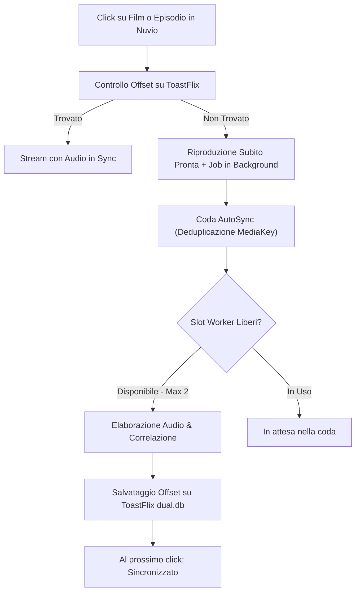

# PriSynx Suite

Suite di plugin per **Nuvio** e **NuvioTV** per lo streaming in lingua italiana e internazionale, con supporto ad auto-delay audio, multi-qualità (fino a 4K) e sorgenti dirette.

---

## 📺 Provider Disponibili (14 Sorgenti)

| Icona | Provider | Contenuti | Risoluzione & Formato | Audio / Sottotitoli | Note & Caratteristiche |
| :---: | :--- | :--- | :--- | :--- | :--- |
| ⚡ | **DualSync** | Film & Serie TV | 4K / 1080p · HLS | 🇮🇹 Audio ITA + 🌐 Originale | Video Cinejoy/Vidfast con mux audio ITA e AutoSync delay |
| 🎬 | **MovyITA** | Film & Serie TV | 1080p · HLS | 🇮🇹 Audio ITA + 🌐 Originale | Flusso Movy con doppia traccia audio sincronizzata |
| 🏰 | **Altadefinizione** | Film & Serie TV | 1080p / 720p · MP4 | 🇮🇹 Audio ITA | CDN MP4 diretta ad alta velocità |
| 🎞️ | **Guardoserie** | Serie TV | 1080p / 720p · HLS / MP4 | 🇮🇹 Audio ITA + Sub-ITA | Player Uqload e Loadm |
| 📺 | **CB01** | Film & Serie TV | 1080p / 720p · MP4 / HLS | 🇮🇹 Audio ITA + Sub-ITA | Risoluzione dinamica probe MP4 su MixDrop |
| 🍿 | **Eurostreaming** | Serie TV | 720p / 1080p · HLS / MP4 | 🇮🇹 Audio ITA + Sub-ITA | MixDrop, Turbovid, DeltaBit con captcha bypass automatico |
| 💎 | **VixSrc** | Film & Serie TV | 1080p / 720p · HLS | 🇮🇹 Audio ITA + Multi-audio + Sub | Streaming HLS con selezione tracce audio e sub |
| 🌐 | **PaCC** | Film & Serie TV | 1080p / 720p · HLS | 🇮🇹 Audio ITA + Sub-ITA | Multi-server HLS con traccia audio italiana |
| 🎨 | **Toonitalia** | Cartoni & Serie TV | 1080p / 720p · HLS / MP4 | 🇮🇹 Audio ITA + Sub-ITA | Cartoni animati, serie vintage e anime (VOE, Uqload) |
| 🍰 | **Real Time** | Canale TV / Reality | 1080p · HLS | 🇮🇹 Audio ITA | Programmi Discovery Italia ufficiali (solo stagioni online) |
| 🏛️ | **RaiPlay** | Fiction, Film & Doc | 1080p · HLS | 🇮🇹 Audio ITA | Catalogo RaiPlay ufficiale in alta definizione (DRM-free) |
| 🌸 | **AnimeWorld** | Anime | 1080p / 720p · MP4 | 🇮🇹 Doppiato + 🇯🇵 SUB-ITA | Link MP4 diretti veloci con mapping automatico |
| 🦊 | **AnimeSaturn** | Anime | 1080p / 720p · HLS / MP4 | 🇮🇹 Doppiato + 🇯🇵 SUB-ITA | StreamPeaker HLS/MP4 con mapping automatico |
| 🏮 | **AnimeUnity** | Anime | 1080p / 720p · HLS | 🇮🇹 Doppiato + 🇯🇵 SUB-ITA | Server VixCloud con bitrate elevato (ITA e SUB) |
| 🏴‍☠️ | **IlCorsaroViola** | Film & Serie TV | 4K / 1080p · Torrent | 🇮🇹 Audio ITA + Multi | Torrent P2P con seeders, formati HEVC/H.264 e bitrate calcolato |

---

## 🎯 Audio Delay Automatico & Manuale

Molti video 4K/FHD e audio ITA provengono da edizioni diverse (es. loghi iniziali o sigle di durata differente). PriSynx include l'offset millimetrico per allinearli.

### 📺 NuvioTV (Android TV / Google TV)
I plugin includono nei metadati dello stream:
```javascript
behaviorHints: {
  audioDelayMs: 1250 // Ritardo in millisecondi (fino a ±60s)
}
```
* **Con la PR [#3781](https://github.com/NuvioMedia/NuvioTV/pull/3781)**: NuvioTV applica il ritardo **automaticamente all'avvio**, senza premere alcun tasto sul telecomando.
* **Supporto NuvioTV**: ExoPlayer e mpv su Android TV supportano l'impostazione del delay audio.

### 📱 Impostazione Manuale (Nuvio Mobile / Finché la PR è in review)
1. Nella lista stream, leggi il valore nel badge (es. `⏱️ +1,25 s`).
2. Avvia la riproduzione.
3. Apri le opzioni audio del player (icona ⚙️ / altoparlante).
4. Imposta manualmente il ritardo indicato.

---

## ⚙️ Come Funziona l'Auto-Misurazione



### Regole di Funzionamento:
* **Trigger al click**: la misurazione **non parte durante la ricerca** nel catalogo, ma solo al click sul singolo episodio (quando vengono risolti gli stream reali).
* **Nessuna attesa**: il video è visibile e riproducibile subito; il calcolo avviene asincrono in background.
* **Coda (Max 2 Worker contemporanei)**: per non sovraccaricare la CPU, AutoSync gestisce massimo 2 elaborazioni parallele. Eventuali altri titoli attendono in coda.
* **Deduplicazione**: richieste multiple dello stesso episodio incrementano le priorità senza duplicare i calcoli.
* **Retry intelligente**: se un titolo era incompatibile nel vecchio database ToastFlix (es. vecchio fastpass), il plugin lo reinvia ad AutoSync per verificarlo con precisione a traccia intera.

---

## 🏷️ Significato dei Badge

| Badge | Significato | Azione |
| :--- | :--- | :--- |
| `⏱️ +X,XX s` | **Offset misurato** | Su NuvioTV si applica da solo; su mobile imposta il valore a mano. |
| `🔊✅ in sync` | **In perfetto sincrono** | Nessun ritardo necessario (< 100 ms). |
| `⏳ da misurare` | **Primo avvio** | Puoi guardare il video subito; calcolo avviato in background. |
| `⏳ in coda` | **In coda** | Coda momentaneamente piena (2 worker attivi); calcolo a breve. |
| `⚙️ in calcolo` | **Calcolo in corso** | Analisi attiva in questo momento (richiede 60–90s). Riapri tra poco. |
| `⛔ versioni diverse` | **Incompatibile** | Montaggi differenti o tagli interni verificati da AutoSync. |

---

## 📦 Installazione in Nuvio

Aggiungi il manifest nella sezione **Plugin** di Nuvio o NuvioTV:

```text
https://raw.githubusercontent.com/qwertyuiop8899/PriSynx/main/manifest.json
```
